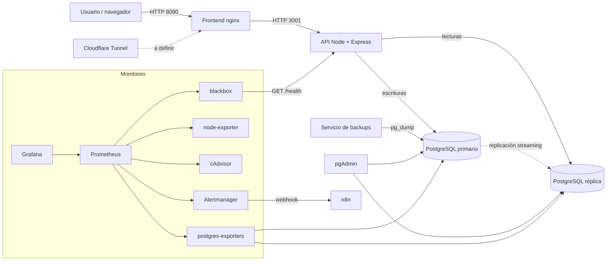

# Diagnóstico de la aplicación – Sistema de Reservas de Hoteles

Práctica Integradora Final – Punto 1: Selección y diagnóstico de la aplicación.
Responsable: Fede. Estado: borrador para revisión del equipo.

> Los ítems marcados con **(confirmar)** hay que verificarlos con el responsable de cada punto antes de la entrega.

## 1. Descripción de la aplicación

Sistema web de reservas para una cadena de hoteles. Permite consultar hoteles, habitaciones y disponibilidad por rango de fechas, y crear, confirmar y cancelar reservas. La base de datos se diseñó y optimizó en el TP de Diseño y Optimización de Bases de Datos y se cargó con datos sintéticos (sin datos personales reales).

Volumen de datos de prueba (según la salida de carga del repo):

| Tabla | Registros |
|---|---|
| hotel | 50 |
| hotel_contacto | 450 |
| habitacion | 14.445 |
| huesped | 500.000 |
| reserva | 6.000.000 |

La tabla `reserva` cumple el mínimo de 6.000.000 de registros pedido en el enunciado. El resto de las tablas de datos hay que revisarlas contra ese mínimo **(confirmar con el responsable de la base)**.

## 2. Funcionalidades

| Funcionalidad | Endpoint | Nodo de base usado |
|---|---|---|
| Estado de la API, del primario y de la réplica | `GET /health` | ambos |
| Listar hoteles | `GET /api/hoteles` | réplica |
| Listar habitaciones de un hotel | `GET /api/habitaciones?hotel_id=` | réplica |
| Consultar disponibilidad por fechas | `GET /api/disponibilidad?hotel_id=&desde=&hasta=` | réplica |
| Ver reservas de un huésped | `GET /api/reservas?huesped_id=` | réplica |
| Crear reserva (queda `pendiente`) | `POST /api/reservas` | primario |
| Confirmar reserva (asigna tarifa) | `PATCH /api/reservas/:id/confirmar` | primario |
| Cancelar reserva | `PATCH /api/reservas/:id/cancelar` | primario |

Reglas de negocio relevantes:
- Una habitación no puede tener dos reservas superpuestas (restricción de exclusión sobre el rango de fechas en `reserva`).
- Si la réplica no responde, las lecturas se hacen en el primario (el header `X-DB-Node` indica qué nodo respondió).
- Las lecturas pueden mostrar un pequeño retraso porque la replicación es asincrónica.

## 3. Inventario del stack tecnológico

| Capa | Tecnología | Versión / detalle |
|---|---|---|
| Frontend | HTML, CSS y JavaScript sin framework | Página única servida por nginx (`nginx:alpine`) |
| Backend | Node.js + Express | Node 20 (imagen `node:20-alpine`), `express` 4.22.3 |
| Acceso a datos | `pg` (node-postgres) | 8.23.1, dos pools (primario y réplica) |
| Base de datos | PostgreSQL | 16, con extensión `btree_gist` |
| Replicación | Streaming replication (primario + 1 réplica) | Réplica creada con `pg_basebackup` |
| Administración de BD | pgAdmin 4 | Imagen `dpage/pgadmin4:latest` |
| Backups | Contenedor con `pg_dump` en bucle | Formato custom (`.dump`), intervalo y retención por variables |
| Monitoreo | Prometheus, Alertmanager, Grafana | v3.16.0 / v0.35.0 / 13.2.6 |
| Exportadores | node-exporter, cAdvisor, postgres-exporter (uno por nodo), blackbox-exporter | Ver rama de monitoreo |
| CI/CD | GitHub Actions + Docker Hub | Construye y publica `hotel-backend` y `hotel-frontend` |
| Contenedores | Docker + Docker Compose | Red interna `red-hoteles` |
| Publicación a Internet | Cloudflare Tunnel (en preparación) **(confirmar)** | Rama `feature/publicacion-internet` |

Dependencias directas del backend: solo `express` y `pg`. No hay servicios externos ni APIs de terceros.

## 4. Infraestructura actual

| Servicio | Contenedor | Puerto en el host | Puerto interno |
|---|---|---|---|
| Frontend | `frontend-hoteles` | 8090 | 80 |
| API | `api-hoteles` | 3001 | 3000 |
| PostgreSQL primario | `db-hoteles` | 5440 | 5432 |
| PostgreSQL réplica | `db-replica` | 5442 | 5432 |
| pgAdmin | `pgadmin-hoteles` | 5050 | 80 |
| Backups | `db-backup` | no publica | – |
| Prometheus | `monitoreo-prometheus` | 127.0.0.1:9090 | 9090 |
| Alertmanager | `monitoreo-alertmanager` | 127.0.0.1:9093 | 9093 |
| Grafana | `monitoreo-grafana` | 127.0.0.1:3000 | 3000 |

Forma de ejecución: Docker Compose sobre una máquina local (Docker Desktop en Windows con WSL2, según la documentación de monitoreo). Hay un `docker-compose.yml` en la raíz (base de datos, réplica, pgAdmin, backups, frontend), otro en `backend/` y otro en `monitoreo/`. Los tres comparten red.

## 5. Diagrama de arquitectura inicial

El diagrama se actualizará cuando estén definidos el túnel, n8n, Mantis y Nextcloud.

## 6. Componentes a contenerizar

| Componente | Estado |
|---|---|
| Base de datos primaria y réplica | Contenerizados |
| pgAdmin y backups | Contenerizados |
| Backend | Contenerizado (`backend/Dockerfile`) |
| Frontend | Contenerizado (`frontend/Dockerfile`) |
| Prometheus, Grafana, Alertmanager y exportadores | Contenerizados (rama de monitoreo) |
| Túnel de acceso a Internet | Pendiente **(confirmar)** |
| Mantis o GLPI | Pendiente |
| n8n | Pendiente |
| Nextcloud | Pendiente |

## 7. Diagnóstico técnico y plan de mejoras

### 7.1 Fortalezas
- Consultas con parámetros y validación de entradas en la API.
- Credenciales fuera del código (variables de entorno; `.env` ignorado por Git).
- Réplica de lectura con respaldo al primario.
- Monitoreo con alertas de disponibilidad, base de datos y replicación.
- Base optimizada con índices justificados y particionamiento.

### 7.2 Mejoras propuestas

| # | Área | Mejora | Prioridad |
|---|---|---|---|
| 1 | Aplicación | Incorporar autenticación y control de acceso por usuario en la API | Alta |
| 2 | Aplicación | Restringir el origen permitido (CORS), limitar la cantidad de pedidos y registrar accesos | Alta |
| 3 | Aplicación | Que el frontend use una ruta relativa a la API, para que funcione desde Internet | Alta |
| 4 | Infraestructura | Publicar al host solo lo necesario; base de datos y pgAdmin accesibles únicamente dentro de la red interna | Alta |
| 5 | Base de datos | Separar usuarios: uno de aplicación con permisos mínimos y otro de solo monitoreo (`pg_monitor`) | Alta |
| 6 | Base de datos | Verificar que la restricción de no superposición de reservas esté activa sobre los datos cargados | Alta |
| 7 | Infraestructura | Unificar los archivos Compose para que haya un único servicio de API | Media |
| 8 | Imágenes | Fijar versiones de todas las imágenes, pasar a una versión vigente de Node, ejecutar nginx sin root y agregar healthchecks | Media |
| 9 | CI/CD | Agregar pruebas, escaneo de vulnerabilidades y bloqueo ante fallas; publicar imágenes con la etiqueta del commit y definir rollback | Alta |
| 10 | CI/CD | Fijar las acciones por versión exacta, limitar permisos del token y usar un token de acceso en lugar de la contraseña de Docker Hub | Media |
| 11 | Monitoreo | Autenticar el webhook hacia n8n y documentar los permisos elevados de cAdvisor | Media |
| 12 | Respaldo | Probar y documentar la restauración de un backup con tiempos | Alta |

El detalle técnico de cada riesgo y su corrección se documenta en el informe de seguridad (punto 14).

## 8. Estado del repositorio

| Rama | Contenido |
|---|---|
| `main` | Base de datos: esquema, carga, consultas e índices |
| `feature/basededatos` | Compose con primario, réplica, pgAdmin y backups |
| `feature/backend` | API Express |
| `feature/front-docker-cicd` | Frontend, Dockerfiles y pipeline de GitHub Actions |
| `feature/punto-10-monitoreo` | Prometheus, Grafana, Alertmanager y exportadores |
| `feature/publicacion-internet` | Acceso a Internet (en preparación) |
| `rendimiento-y-concurrencia` | Particionamiento y pruebas de rendimiento |
