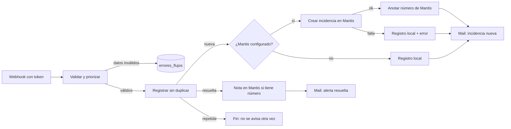
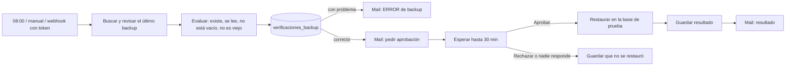
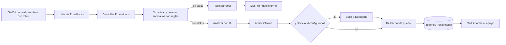

# Automatización con n8n (punto 13)

Tres flujos de n8n que conectan el monitoreo, los backups, la gestión de incidencias, la
gestión documental, una IA y el mail. Todo corre en Docker y se levanta con tres comandos.

## En números

| Qué | Cuánto |
|---|---|
| Contenedores | 3 (`n8n-hoteles`, `n8n-runners`, `n8n-db-verificacion`) |
| Flujos | 3 |
| Componentes del proyecto integrados | 5: Prometheus/Alertmanager (punto 10), backups de la base (punto 4), Mantis (punto 11), Nextcloud (punto 12) y mail. Además, una IA externa (Gemini) |
| Webhooks | 3, los tres con token |
| Credenciales en n8n | 6, cifradas. Ninguna clave en los flujos ni en el repo |
| Tablas de control | 4 (incidencias, verificaciones de backup, informes, errores) |

**Estado real al 17/11/2026** (para no afirmar de más):

| Integración | Estado |
|---|---|
| Alertmanager → n8n con token | Probado de punta a punta |
| Backups: verificación y restauración con aprobación | Probado de punta a punta |
| Prometheus → informe | Probado con métricas reales |
| Mantis | [PENDIENTE – Seba – levantar Mantis]. Probado contra un simulador de su API; con Mantis vacío en el `.env` las incidencias quedan en la tabla local |
| Nextcloud | [PENDIENTE – Fede – levantar Nextcloud]. Probado contra un simulador de WebDAV; con Nextcloud vacío los informes quedan en la tabla local |
| Mail por Brevo | Probado con un servidor de correo de prueba. [PENDIENTE – cargar usuario y clave de Brevo en `.env` y probar un envío real] |
| IA (Gemini) | El flujo funciona sin ella. [PENDIENTE – cargar `GEMINI_API_KEY` y probar el análisis real] |

## Qué hay y para qué sirve cada cosa

```
                          ┌──────────────────────── n8n (este compose) ────────────────────────┐
 Alertmanager ──token──►  │ Flujo 1: Alertas ──► Mantis (o registro local) ──► mail            │
 (monitoreo/)             │                                                                    │
 carpeta backups/ ──ro──► │ Flujo 2: Backups ──► verifica ──► pide aprobación ──► restaura     │
 (db-backup)              │                      en n8n-db-verificacion, nunca en producción   │
 Prometheus ───────────►  │ Flujo 3: Informe ──► reglas + IA ──► Nextcloud (o local) ──► mail  │
                          │                                                                    │
                          │ n8n-db-verificacion: tablas de control + base de restauración      │
                          └────────────────────────────────────────────────────────────────────┘
```

| Contenedor | Imagen | Para qué |
|---|---|---|
| `n8n-hoteles` | `n8nio/n8n:2.45.7` | Editor y motor de los flujos. Puerto 5678, solo en `127.0.0.1` |
| `n8n-runners` | `ghcr.io/n8n-io/runners:2.45.7` | Ejecuta el código de los nodos Code, separado de n8n |
| `n8n-db-verificacion` | `postgres:16` | Tablas de control de los flujos y base donde se restaura el backup de prueba. Sin puertos publicados |

### Por qué este compose y no el del instalador tal cual

La guía de la cátedra instala n8n con el instalador oficial (`curl -fsSL https://get.n8n.io | sh`).
Ese instalador genera un compose con 6 contenedores. Partimos de ese compose y dejamos lo que
usan los flujos: `n8n` y `runners`. Sacamos dos cosas:

- el *sandbox* (3 contenedores, uno con `privileged: true` y Docker adentro): es para una función
  de n8n que no usamos, y un contenedor con privilegios totales es un riesgo que no hace falta correr;
- el buscador `searxng`: los flujos no buscan en la web.

Menos contenedores también significa menos carga en la PC de la defensa.

### Archivos

| Archivo | Qué es |
|---|---|
| `docker-compose.yml` | Los 3 contenedores, la red y los volúmenes |
| `.env.example` | Variables a completar. El `.env` real no se sube |
| `preparar.ps1` | Crea el `.env`, genera las claves internas y deja el token para Alertmanager |
| `importar.ps1` | Carga las credenciales y los 3 flujos en n8n y los activa |
| `db/inicio.sql` | Tablas de control, funciones y el usuario limitado de n8n |
| `herramientas/credenciales.js` | Lo que usa `importar.ps1` para pasar las claves del `.env` a n8n |
| `flujos/*.json` | Los 3 flujos exportados, sin credenciales |

## Los 3 flujos

Los tres siguen la misma idea: **validar** lo que entra, **registrar** lo que pasa en una tabla,
**avisar** por mail y, si una tarea falla, **seguir por otro camino** y anotar el error.

### Flujo 1 – Alertas de infraestructura

Prometheus detecta una anomalía → Alertmanager avisa a n8n → n8n registra la incidencia → avisa al responsable.



| | |
|---|---|
| **Disparador** | Webhook `POST /webhook/alertas-prometheus`. Lo llama Alertmanager con la cabecera `Authorization: Bearer <token>`. Sin token o con token incorrecto, n8n responde 403 |
| **Condiciones** | 1) ¿Los datos son válidos? 2) ¿Es una incidencia nueva, repetida o resuelta? 3) ¿Mantis está configurado? 4) ¿Mantis respondió? |
| **Acciones** | Registrar en `incidencias_alertas`, crear la incidencia en Mantis (`POST /api/rest/issues`), agregar una nota al resolverse, mandar mail |
| **Si algo falla** | Mantis no responde (2 intentos): la incidencia queda en el registro local y el mail lo dice. El mail falla: queda anotado en `errores_flujos`. La incidencia nunca se pierde |

Dos decisiones tomadas de la unidad de Gestión de Incidentes:

- **No duplicar.** "Comprobación de que ese incidente aún no ha sido registrado". Alertmanager repite
  el aviso cada 4 h mientras la alerta sigue activa. La *huella* de una incidencia es `alerta|instancia`.
  Si ya hay una abierta con esa huella, se suma una repetición y no se crea otra ni se manda otro mail.
  Lo garantiza la base con un índice único parcial, no solo el flujo.
- **Prioridad = impacto + urgencia.** El impacto sale de qué se rompe (si el usuario no puede reservar,
  es alto). La urgencia sale de la severidad de la regla de Prometheus.

| Impacto \ Urgencia | alta (`critical`) | media (`warning`) | baja |
|---|---|---|---|
| **alto** (ApiCaida, BasePrincipalCaida) | urgente | alta | normal |
| **medio** (réplica, contenedor, conexiones, disco) | alta | normal | baja |
| **bajo** (el resto) | normal | baja | baja |

La incidencia **no se cierra sola** cuando la alerta se resuelve: se agrega una nota y el cierre
lo hace una persona con evidencia (como pide el punto 11).

### Flujo 2 – Verificación de backups

Se ejecuta una copia → se verifica → se registra → se notifica cualquier error. La restauración
se comprueba con una prueba controlada y aprobada por una persona.



| | |
|---|---|
| **Disparadores** | Todos los días a las 08:00, botón "Probar ahora" en el editor, o webhook `POST /webhook/verificar-backups` con token |
| **Condiciones** | 1) ¿El backup está bien? Cuatro controles: existe, `pg_restore --list` lo puede leer, pesa más que `BACKUP_MIN_BYTES`, tiene menos de `BACKUP_MAX_HORAS`. 2) ¿La persona aprobó? |
| **Acciones** | Registrar en `verificaciones_backup`, mandar mail de error o de pedido de aprobación, restaurar con `pg_restore` en la base `restauracion_prueba`, contar tablas y filas, mandar el resultado |
| **Si algo falla** | Backup viejo, vacío o ilegible: mail de error. No se puede mandar el pedido de aprobación: no se restaura y queda anotado. `pg_restore` falla: se registra como `restauracion = error` y se avisa |

**Aprobación humana.** La consigna pide "solicitar aprobación humana antes de ejecutar acciones
críticas". Restaurar una base consume disco y CPU, así que el flujo no lo hace solo: manda un mail
con dos enlaces (Aprobar / Rechazar) y se queda esperando con el nodo *Wait*. Los enlaces están
firmados por n8n: si alguien cambia la firma, responde 401. Si nadie contesta en 30 minutos, no se
restaura y queda como "sin respuesta".

**La restauración no toca producción.** `n8n-db-verificacion` es un PostgreSQL aparte que ve la
carpeta `backups/` en **solo lectura** y no tiene conexión con `db-hoteles`.

### Flujo 3 – Informe de rendimiento asistido por IA

Se recopilan métricas → se analizan → n8n organiza el resultado → se guarda en Nextcloud → se avisa al equipo.



| | |
|---|---|
| **Disparadores** | Todos los días a las 09:00, botón "Probar ahora", o webhook `POST /webhook/informe-rendimiento` con token |
| **Condiciones** | 1) ¿Prometheus devolvió métricas? 2) ¿La IA respondió? 3) ¿Nextcloud está configurado y respondió? |
| **Acciones** | 11 consultas a Prometheus, comparación contra umbrales, pedido a Gemini, armado del informe, subida a Nextcloud por WebDAV (`PUT /remote.php/dav/files/...`), registro en `informes_rendimiento`, mail |
| **Si algo falla** | Prometheus no responde: no hay informe, se registra y se avisa. La IA falla: el informe sale igual, sin esa sección. Nextcloud falla: el informe queda en la tabla local. Cada fallo queda en `errores_flujos` |

**Un informe que no inventa.** En la práctica de automatización vimos la "mitigación de
alucinaciones". Acá se aplica así:

1. Los números y las anomalías **no los decide la IA**: salen de Prometheus y de comparar contra
   umbrales fijos, que son los mismos de las reglas de alerta del punto 10.
2. La IA recibe solo esa tabla, con la instrucción de usar únicamente esos datos, no cambiar
   ningún estado y decir "no se puede concluir" si no alcanza. Temperatura 0,2.
3. En el informe, la tabla de números y el texto de la IA van en secciones separadas, y el texto
   de la IA está marcado como interpretación.
4. Si la IA no responde, el informe sale igual.

A Gemini se le manda solamente la tabla de métricas de infraestructura. Ningún dato de huéspedes,
ninguna clave.

Las métricas son generales (CPU, memoria, disco, disponibilidad y tiempo de respuesta de la API,
conexiones, réplica, contenedores, alertas). **No se analizan consultas SQL individuales.**

## Requisitos de seguridad del punto 13

| Requisito de la consigna | Cómo se cumple | Cómo se demuestra |
|---|---|---|
| Proteger la interfaz de administración | n8n pide usuario y clave (cuenta de dueño). El puerto 5678 se publica solo en `127.0.0.1` | Abrir `http://localhost:5678`: pide login. Desde otra PC de la red no abre |
| Autenticar los webhooks | Los 3 webhooks exigen `Authorization: Bearer <token>`. Los enlaces de aprobación van firmados | `POST` sin token devuelve 403; enlace con la firma cambiada devuelve 401 |
| Evitar secretos en los flujos | Los flujos solo nombran la credencial. Las claves están en `.env` (ignorado por git) y en n8n, cifradas | Abrir cualquier `flujos/*.json`: no hay claves. `git status` no muestra `.env` |
| Restringir los permisos de las credenciales | n8n entra a la base con `n8n_flujos`, que no es administrador: no puede borrar, ni crear tablas, ni leer archivos, ni ejecutar programas. Para Nextcloud se usa una contraseña de aplicación; para Mantis, el token de un usuario que solo reporta | Ver "Prueba de permisos" más abajo |
| Validar los datos recibidos | El flujo 1 revisa la forma del aviso, limita la cantidad de alertas, acepta solo nombres con letras, números y `_`, recorta los textos. Las funciones SQL solo aceptan nombres de backup con el formato `hoteles_AAAAMMDD_HHMMSS.dump` | Mandar una alerta con `'; DROP TABLE` en el nombre: se descarta y queda en `errores_flujos` |
| Controlar las acciones automáticas que puedan interrumpir servicios | Ningún flujo detiene, reinicia ni borra nada. Los backups se leen en solo lectura. La restauración va a una base aparte | `docker exec n8n-db-verificacion touch /backups/x` da "Read-only file system" |
| Aprobación humana antes de acciones críticas | La restauración de prueba espera la aprobación de una persona | Flujo 2: llega el mail, se toca Aprobar y recién ahí se restaura |

## Cómo levantarlo en otra PC

Requisitos: Docker Desktop y PowerShell. La base, la API y el monitoreo tienen que estar
levantados antes (ver `monitoreo/README.md`).

```powershell
cd n8n
```
```powershell
.\preparar.ps1
```
Crea `.env`, genera las 4 claves internas y copia el token a `monitoreo/alertmanager/secretos/`.
Si PowerShell no deja ejecutar scripts: `powershell -ExecutionPolicy Bypass -File .\preparar.ps1`.

Completar a mano en `n8n\.env`: los datos de Brevo (`SMTP_USER`, `SMTP_PASSWORD`, `MAIL_REMITENTE`,
`MAIL_DESTINO`) y `GEMINI_API_KEY`. Mantis y Nextcloud se completan cuando estén levantados; si
quedan vacíos, los flujos usan el registro local.

```powershell
docker compose up -d
```
```powershell
.\importar.ps1
```
Carga las 6 credenciales y los 3 flujos, los activa y reinicia n8n.

Para que Alertmanager tome el token (una sola vez):
```powershell
docker compose -f ..\monitoreo\docker-compose.yml --env-file ..\monitoreo\.env up -d alertmanager
```

Por último, abrir `http://localhost:5678` y **crear la cuenta de dueño** (mail y contraseña). Es lo
que protege el editor. Los flujos ya están adentro.

Para comprobar todo de una vez, desde la raíz del repo:
```powershell
.\scripts\verificar.ps1
```

Si se cambia algo del `.env`: `docker compose up -d` y de nuevo `.\importar.ps1`.

Atención: `docker compose down -v` borra los volúmenes (flujos cargados, historial y tablas de
control). Para apagar sin perder nada, `docker compose down` sin `-v`.

## Cómo demostrarlo en vivo

Guardar el token en una variable (no se muestra en pantalla), parados en la raíz del repo:
```powershell
$t = (Select-String -Path .\n8n\.env -Pattern '^WEBHOOK_TOKEN=(.+)$').Matches[0].Groups[1].Value
```

**1. Los webhooks están protegidos** (responde 403):
```powershell
try { Invoke-WebRequest -UseBasicParsing -Method Post http://localhost:5678/webhook/alertas-prometheus } catch { $_.Exception.Response.StatusCode.value__ }
```

**2. Flujo 1 con una alerta real.** Detener la API, esperar unos 2 minutos (1 min de la regla más 30 s
de agrupación de Alertmanager) y mostrar el mail y la incidencia:
```powershell
docker stop api-hoteles
```
```powershell
docker exec n8n-db-verificacion psql -U postgres -d automatizacion -c "SELECT id, alerta, prioridad, estado, repeticiones, registro, mantis_id FROM incidencias_alertas ORDER BY id DESC LIMIT 5;"
```
```powershell
docker start api-hoteles
```
Al detener la API saltan dos alertas (`ApiCaida` y `ContenedorSinReportar`), así que se crean dos
incidencias y llegan dos mails. El aviso de "resuelta" llega cuando Alertmanager vuelve a revisar
el grupo (hasta 5 minutos después).

Si no hay tiempo para esperar, se puede mandar una alerta de prueba a Alertmanager (no a n8n), y
llega igual por el camino real en unos 30 segundos:
```powershell
Invoke-RestMethod -Method Post -Uri http://127.0.0.1:9093/api/v2/alerts -ContentType 'application/json' -Body '[{"labels":{"alertname":"PruebaDefensa","instance":"demo","severity":"warning"},"annotations":{"summary":"Alerta de prueba para la defensa"}}]'
```

**3. Flujo 2, backup y aprobación.** En el editor, abrir "HIA 2 - Verificación de backups" y tocar
*Execute workflow*, o por comando:
```powershell
Invoke-RestMethod -Method Post -Uri http://localhost:5678/webhook/verificar-backups -Headers @{ Authorization = "Bearer $t" }
```
Llega el mail. Si el backup está bien, tocar **Aprobar** (desde la PC donde corre n8n) y mostrar el resultado:
```powershell
docker exec n8n-db-verificacion psql -U postgres -d automatizacion -c "SELECT id, archivo, estado, aprobacion, restauracion, tablas_restauradas, filas_reserva, duracion_seg FROM verificaciones_backup ORDER BY id DESC LIMIT 3;"
```
```powershell
docker exec n8n-db-verificacion psql -U postgres -d restauracion_prueba -c "\dt"
```
Con 6.000.000 de reservas la restauración tarda varios minutos (el índice de no superposición es lo
más lento): conviene aprobarla y seguir con otra parte de la demo mientras termina.

**4. Flujo 3, informe:**
```powershell
Invoke-RestMethod -Method Post -Uri http://localhost:5678/webhook/informe-rendimiento -Headers @{ Authorization = "Bearer $t" }
```
```powershell
docker exec n8n-db-verificacion psql -U postgres -d automatizacion -At -c "SELECT contenido FROM informes_rendimiento ORDER BY id DESC LIMIT 1;"
```

**5. Qué pasa cuando una tarea falla.** Por ejemplo, con Mantis apagado o sin configurar, repetir el
paso 2: la incidencia queda con `registro = local` y el mail lo aclara. El registro de errores:
```powershell
docker exec n8n-db-verificacion psql -U postgres -d automatizacion -c "SELECT id, fecha, flujo, tarea, left(detalle, 80) AS detalle FROM errores_flujos ORDER BY id DESC LIMIT 10;"
```

**6. Registro de ejecuciones.** En el editor, menú *Executions*: se ven todas (bien y mal), con los
datos que pasaron por cada nodo. Se guardan 14 días.

**7. Prueba de permisos** del usuario de n8n en la base (los cuatro comandos tienen que dar error):
```powershell
docker exec n8n-db-verificacion psql -U n8n_flujos -d automatizacion -c "DELETE FROM errores_flujos;" -c "CREATE TABLE x(a int);" -c "SELECT pg_ls_dir('/backups');" -c "SELECT * FROM revisar_backup('x.dump; rm -rf /');"
```

## Evidencias de las pruebas (17/11/2026)

Hechas en una PC con Windows y Docker Desktop. Mantis y Nextcloud todavía no existen, así que
para probar esa integración se usó un programa chico que responde como sus APIs y anota lo que
recibe. El mail se probó con un servidor de correo de prueba. Ninguno de los dos queda en el repo.

### Flujo 1

| Prueba | Resultado |
|---|---|
| `POST` sin token | 403 |
| `POST` con token incorrecto | 403 |
| Token correcto, cuerpo que no es de Alertmanager | Se descarta. Error: "El pedido no trae la lista alerts de Alertmanager" |
| Aviso con 2 alertas válidas y 1 con `'; DROP TABLE` en el nombre | 2 incidencias creadas (ApiCaida = urgente, CpuAlta = baja), la tercera descartada. 2 mails |
| El mismo aviso otra vez | 0 incidencias nuevas, `repeticiones = 2`, 0 mails |
| Alerta resuelta | Incidencia en `resuelta` con hora de fin. 1 mail |
| Con Mantis (simulado): alerta nueva | Mantis recibió `POST /api/rest/issues` con token, proyecto, categoría y `priority = urgent`. Incidencia con `registro = mantis` y su número |
| Con Mantis (simulado): alerta resuelta | Mantis recibió `POST /api/rest/issues/101/notes` |
| Mantis caído | 2 intentos, error "timeout of 8000ms exceeded" en `errores_flujos`, incidencia con `registro = local`, mail enviado |
| Mantis y mail caídos a la vez | La incidencia quedó registrada igual; 2 errores anotados (Mantis y mail) |
| Camino real: alerta de prueba mandada a Alertmanager | Alertmanager la envió con el token y n8n la registró. Sin errores en el log de Alertmanager |

### Flujo 2

| Prueba | Resultado |
|---|---|
| `POST` sin token | 403 |
| Backup de 95 h con máximo de 26 h | `estado = viejo`, mail "ERROR en el backup: viejo". No pide aprobación |
| Backup aceptado | `estado = ok`, 101 objetos listados por `pg_restore`, mail con los dos enlaces |
| Enlace de aprobación con la firma cambiada | 401 |
| Aprobar | `aprobacion = aprobada`, `restauracion = ok`, 12 tablas restauradas, 0,49 s. Mail con el resultado |
| Rechazar | `aprobacion = rechazada`, no se restauró |
| Nadie responde | A los 30 minutos quedó `aprobacion = sin_respuesta` y no se restauró. La ejecución en espera sobrevivió a varios reinicios de n8n |

La base de esa PC estaba vacía (solo el esquema, sin la carga masiva), por eso el backup pesa 34 KB y
`filas_reserva` da 0. Además el control de antigüedad detectó un problema real: el servicio `db-backup`
no generaba copias desde hacía 4 días.

### Flujo 3

| Prueba | Resultado |
|---|---|
| `POST` sin token | 403 |
| Con Prometheus real | 11 de 11 métricas con valor, 0 anomalías. Informe guardado y enviado |
| Sin clave de Gemini | El informe salió igual. Sección de IA: "No disponible… API key not valid". Error anotado |
| Con Nextcloud (simulado) | Recibió `PUT /remote.php/dav/files/informes/Informes/informe_rendimiento_2026-11-17_0102.md` con usuario y clave. `destino = nextcloud` |
| Sin Nextcloud | `destino = local`: el informe quedó en `informes_rendimiento` |
| Prometheus inalcanzable | No se generó informe. Error "Prometheus no devolvió ninguna métrica". Mail de aviso |

### Permisos del usuario `n8n_flujos`

| Intento | Respuesta de PostgreSQL |
|---|---|
| `DELETE FROM errores_flujos` | permission denied for table errores_flujos |
| `CREATE TABLE x(a int)` | permission denied for schema public |
| `SELECT pg_ls_dir('/backups')` | permission denied for function pg_ls_dir |
| `COPY ... FROM PROGRAM 'id'` | permission denied to COPY to or from an external program |
| `revisar_backup('x.dump; rm -rf /')` | Nombre de backup no permitido |
| `touch /backups/prueba` dentro del contenedor | Read-only file system |

## Análisis de riesgos de las automatizaciones

| Riesgo | Qué podría pasar | Qué hicimos | Qué queda |
|---|---|---|---|
| Alguien llama al webhook de alertas | Incidencias y mails falsos | Token obligatorio, validación de datos, tope de 50 alertas por aviso, n8n publicado solo en `127.0.0.1` | El token es uno solo para los 3 webhooks. Si se filtra hay que cambiarlo en `.env` y volver a ejecutar `preparar.ps1` e `importar.ps1` |
| Datos maliciosos dentro de una alerta | Inyección en la base o en Mantis | Nombres con lista de caracteres permitidos, textos recortados, consultas con parámetros (`$1`), nunca SQL armado con texto | — |
| Tormenta de alertas | Cientos de mails e incidencias | Alertmanager agrupa e inhibe; n8n no duplica incidencias abiertas | Muchas alertas *distintas* a la vez generan un mail cada una |
| Se filtra una clave | Acceso a Brevo, Gemini, Mantis o Nextcloud | Claves solo en `.env` (ignorado) y cifradas en n8n. Los flujos exportados no las traen. `importar.ps1` no las muestra | La clave de cifrado de n8n vive en su volumen: quien tenga acceso a Docker en esa PC puede leerla |
| Los flujos pueden leer variables de entorno | Un flujo podría leer el token interno entre n8n y su ejecutor | En las variables de n8n solo hay configuración no secreta, más ese token interno. Solo el dueño puede editar flujos | Se eligió así para no escribir direcciones y mails dentro de los flujos |
| La restauración automática | Pisar datos o saturar la PC | Base aparte, backups en solo lectura, aprobación humana, 2 trabajos en paralelo como máximo | Con 6M de filas usa disco y CPU varios minutos |
| El usuario de la base usado por n8n | Borrar historial o ejecutar comandos | Usuario sin `DELETE`, sin crear objetos; las tareas delicadas están en funciones que validan el nombre del archivo | Las funciones de backup corren con permisos de administrador *dentro* de esa base aislada |
| La IA inventa o se cae | Informe con datos falsos o sin informe | Los números no los pone la IA; prompt restrictivo; el informe sale igual sin IA | El texto de la IA puede ser impreciso: por eso va marcado como interpretación |
| Datos que salen a un servicio externo | Exponer información a Google | Solo se mandan métricas de infraestructura, sin datos personales | Las métricas revelan nombres de servicios internos |
| n8n se cae | No se registran alertas | `restart: unless-stopped`; Alertmanager reintenta; las alertas se siguen viendo en Prometheus y Grafana | Nadie vigila a n8n: no está entre los targets de Prometheus |
| Enlaces de aprobación | Que apruebe quien no debe | Enlace firmado, vence a los 30 min, llega solo a `MAIL_DESTINO`, funciona solo desde la PC de n8n | Quien tenga acceso a esa casilla puede aprobar |

## Limitaciones conocidas

- **Mantis y Nextcloud reales sin probar.** La integración está hecha según sus APIs y probada con
  un simulador. Cuando existan hay que completar el `.env`, ejecutar `importar.ps1` y repetir las
  pruebas. Puede hacer falta ajustar el nombre de la categoría o del proyecto.
- **Mail real y Gemini real sin probar** hasta cargar las claves.
- **La aprobación es por enlace**, sin usuario y contraseña propios.
- **n8n no se publica en Internet** a propósito. Por eso los enlaces de aprobación solo abren en
  la PC donde corre.
- **Un solo ejecutor de código.** Alcanza para tres flujos; con mucha carga habría que sumar ejecutores.
- **El historial de ejecuciones se guarda 14 días** en SQLite, dentro del volumen de n8n. Las
  tablas de control no se borran solas.
- **La zona horaria** de los flujos y de la base de control es `America/Argentina/Jujuy`. La base
  de producción sigue en UTC.
